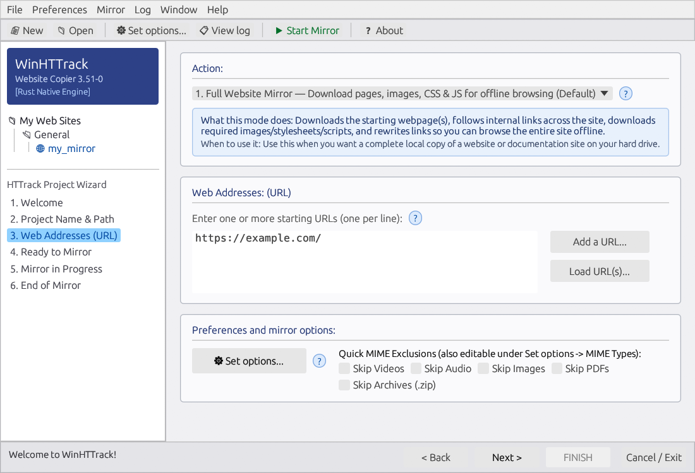
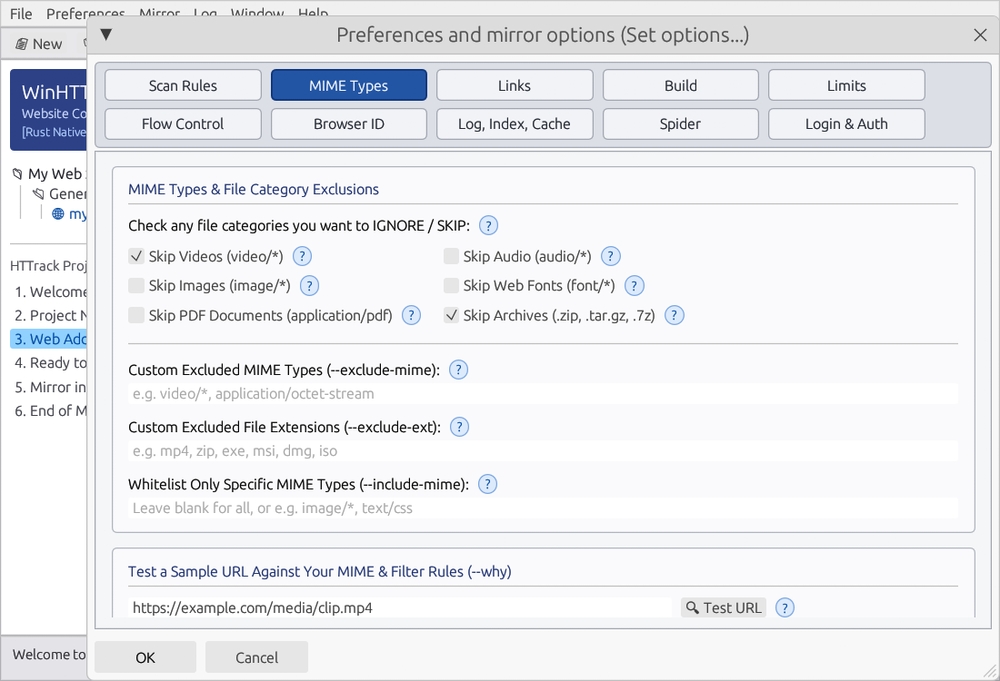

# HTTrack Website Copier — Rust Alternative (`httrack-rs`)

> **Upstream Attribution & Credits:**
> This project is an **unofficial, community memory-safe Rust alternative** to [**HTTrack Website Copier**](https://www.httrack.com/), originally created and maintained by **Xavier Roche** ([@xroche](https://github.com/xroche)) and contributors.
> * **Official HTTrack Website:** [https://www.httrack.com/](https://www.httrack.com/)
> * **Official Upstream C Repository:** [https://github.com/xroche/httrack](https://github.com/xroche/httrack)
> * **Official Forum & Documentation:** [https://forum.httrack.com/](https://forum.httrack.com/)
> * **License:** GPL-3.0-or-later (preserving upstream HTTrack licensing and templates)

> [!WARNING]
> **AI "Vibe Coded" Disclaimer & How to Request Updates:**
> * This Rust reimplementation was **vibe coded with Gemini 4 Argon**.
> * **No Warranty / No Liability:** This software is provided strictly **"AS IS"** without warranty of any kind. The repository owner assumes **no responsibility or liability** for any bugs, edge cases, or issues that arise from using it.
> * **Want a Feature or Bug Fix? Send a Plug-and-Play AI Prompt!** If you open a GitHub Issue requesting a fix or feature, please include a **ready-to-paste AI prompt** describing the exact change you want so it can be plugged straight into the AI when time permits.

---

## Screenshots

### 1. Classic WinHTTrack Main Wizard (`WinHTTrack.exe`)
*Features clear Action descriptions, inline **"What this mode does / When to use it"** guidance, interactive **`[ ? ]`** info bubbles, and quick MIME exclusions:*



### 2. Redesigned Preferences & Mirror Options (`Set options...`)
*Features framed 2-row folder tabs, section dividers, **`[ ? ]`** explanation bubbles on every setting, one-click Two-Stage MIME exclusions, and a live URL Rule Tester (`--why`):*



---

## Ready-to-Run Download (No Compiling or Rust Installation Required!)

Want to run **WinHTTrack** right now without installing Rust or compiling anything?

1. Go to the [**Releases Page**](../../releases/latest).
2. Download either:
   * **`WinHTTrack.exe`** (Standalone Native Windows Desktop GUI — double-click and run!), **or**
   * **`httrack-rs-v3.51.0-windows-x64.zip`** (Full Portable Bundle containing `WinHTTrack.exe`, `httrack.exe` CLI, `webhttrack.exe` Web UI server, and `assets/`).
3. Double-click **`WinHTTrack.exe`** to launch the classic WinHTTrack Project Wizard directly on your desktop.

---

## Why a Rust Alternative? (What's Improved)

While preserving the familiar classic **WinHTTrack** Wizard layout and file/cache formats (`hts-cache/new.zip`, `hts-changes.json`, `hts-log.txt`, ISO-28500 `.warc.gz`, and 4-char MD5 query-string save names), this Rust engine modernizes several pain points from the original C application:

### 1. Reliable Two-Stage MIME & File Type Filtering
In classic HTTrack, excluding MIME types (such as `-mime:video/*` or `-mime:image/*`) often failed because delayed type checking queued URLs and opened connections before checking their MIME rules.
* **Stage 1 (Pre-Flight Extension & MIME Inference):** Infers MIME types from URL extensions (`.mp4` -> `video/mp4`, `.png` -> `image/png`, `.pdf` -> `application/pdf`, `.zip` -> `application/zip`) and blocks excluded types **before opening any network connection**.
* **Stage 2 (HTTP `Content-Type` Header Gate):** Inspects the server's `Content-Type` and `Content-Length` headers on dynamic endpoints and aborts excluded MIME types before downloading the response body.
* **One-Click Checkboxes & Shorthands:** Easily skip `Videos (video/*)`, `Audio (audio/*)`, `Images (image/*)`, `Web Fonts (font/*)`, `PDFs`, or `Archives (.zip)` from the GUI or via `--exclude-mime video,audio,pdf,archive`.

### 2. Clear Action Names, `[ ? ]` Info Bubbles & Rule Validator in the GUI
* **Self-Explanatory Action Modes:** Replaces confusing legacy labels (like *"Get individual files"*) with clear descriptions and an inline banner explaining **What this mode does** and **When to use it**.
* **Interactive `[ ? ]` Info Bubbles Everywhere:** Hover over or click any blue **`[ ? ]`** button next to any setting in the Wizard or the 10-tabbed **`Set options...`** window to open a plain-English explanation.
* **`✔ Check Rules for Errors` Button:** Located in **`Set options...` -> `Scan Rules`**, validates your wildcard scan rules for missing `+`/`-` prefixes, unbalanced brackets, or rule-order mistakes (`-*` at the end), plus a **Live URL Rule Tester (`--why`)** to test any URL before starting a crawl.

### 3. Modern Browser Impersonation & Session Auth (Replaces Legacy Proxy Setup)
* **`--impersonate <chrome|firefox|safari|classic>`:** Sends realistic desktop browser headers (`User-Agent`, `Sec-CH-UA`, `Accept`) so sites behind Cloudflare or modern CDNs don't block the mirror.
* **`--auth <TOKEN_OR_USER:PASS>` & `--cookie <COOKIES>` / `--cookies-file <PATH>`:** Mirror authenticated or logged-in sites directly by pasting a Bearer token, Basic login, or browser session cookies without configuring an intercept proxy.

---

## Included Executables

| Executable | Description |
| :--- | :--- |
| **`WinHTTrack.exe`** | **Native Windows Desktop GUI** (`eframe`/`egui`). Opens the classic WinHTTrack 6-step Project Wizard and 10-tabbed `Set options...` window with zero console window. |
| **`httrack.exe`** | **Command-Line Interface (CLI)** & interactive terminal wizard. Supports classic HTTrack flags plus modern `--exclude-mime`, `--exclude-ext`, `--impersonate`, `--auth`, `--cookie`, and `--why`. |
| **`webhttrack.exe`** | **Local Web GUI Server** (`http://127.0.0.1:8080`) for browser-based or headless/remote control. |

---

## Building from Source (Optional)

If you prefer to compile from source yourself:

```bash
cargo build --release --bins
```

The stripped release binaries will be output to `target/release/`:
* `target/release/WinHTTrack.exe`
* `target/release/httrack.exe`
* `target/release/webhttrack.exe`

---

## Credits & License

* **Original HTTrack Author:** [Xavier Roche](https://github.com/xroche) & contributors ([https://www.httrack.com/](https://www.httrack.com/))
* **Upstream Source:** [https://github.com/xroche/httrack](https://github.com/xroche/httrack)
* **License:** [GNU General Public License v3.0 or later (GPL-3.0-or-later)](LICENSE)
